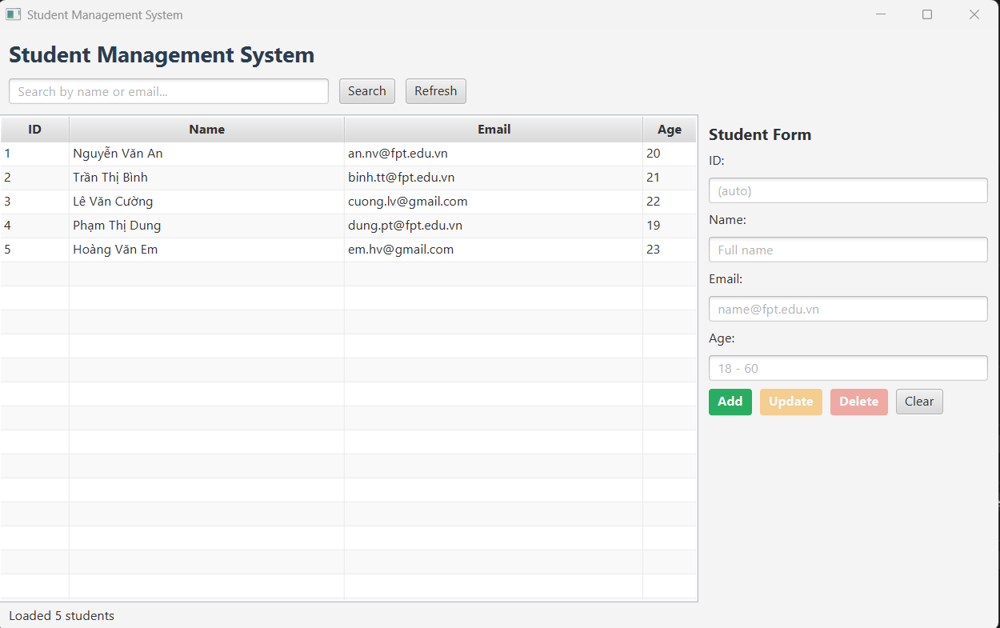
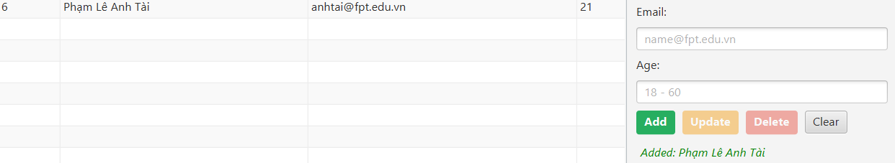
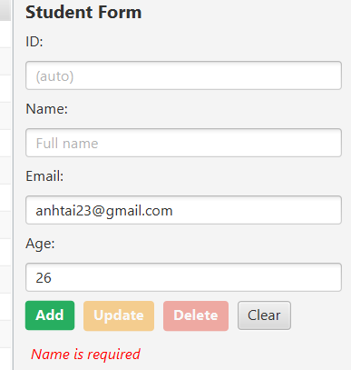
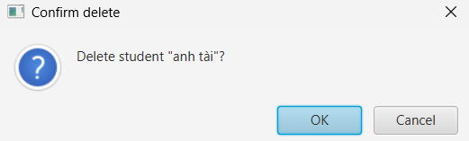

# Student Management System

Ứng dụng quản lý sinh viên bằng **JavaFX + Spring Boot + Spring Data JPA**, theo kiến trúc N-Layer, Maven multi-module.

- Tác giả: _<Phạm Lê Anh Tài> - <DE190702>_
- Môn: HSF302 - Slot 16

## Chức năng

- Xem danh sách sinh viên, tìm kiếm theo tên hoặc email (không phân biệt hoa thường, Enter = Search).
- Thêm, sửa, xóa sinh viên; xóa luôn có hộp thoại xác nhận.
- Kiểm tra dữ liệu ở tầng Service: tên bắt buộc và tối đa 100 ký tự, email hợp lệ và không trùng, tuổi từ 18 đến 60.

## Môi trường

| Thành phần | Phiên bản |
|---|---|
| JDK | 21 trở lên (project biên dịch với `release 21`) |
| Maven | Dùng Maven Wrapper có sẵn (`mvnw`), không cần cài riêng |
| SQL Server | 2019 trở lên, bật TCP/IP port 1433 |
| Spring Boot | 3.5.x |
| JavaFX | 21 |

## Tạo database

Mở SQL Server Management Studio và chạy:

```sql
IF DB_ID('StudentDB') IS NULL CREATE DATABASE StudentDB;
```

Bảng `students` sẽ do Hibernate tự tạo khi chạy ứng dụng lần đầu (`ddl-auto=update`).

## Cấu hình kết nối

Sửa file `ui-module/src/main/resources/application.properties`, đổi `username` và `password` theo máy của bạn:

```properties
spring.datasource.url=jdbc:sqlserver://localhost:1433;databaseName=StudentDB;encrypt=false;trustServerCertificate=true
spring.datasource.username=sa
spring.datasource.password=<mật khẩu của bạn>
```

## Build, test và chạy

Chạy các lệnh sau trong thư mục `student-management`:

```powershell
# Build toàn bộ project và chạy test
.\mvnw -q clean install

# Chỉ chạy test của data-module (26 test: 10 Repository + 16 Service, dùng H2 trong bộ nhớ)
.\mvnw -pl data-module test

# Chạy ứng dụng
.\mvnw -q clean install -DskipTests
.\mvnw -f ui-module/pom.xml spring-boot:run
```

Hoặc trong IntelliJ: chuột phải `ui-module/src/main/java/com/example/ui/Launcher.java` và chọn **Run**.
Hãy chạy `Launcher`, không chạy trực tiếp `JavaFxApplication`, để tránh lỗi "JavaFX runtime components are missing".

## Kiến trúc

```
student-management
├── data-module                 (tầng dữ liệu, không phụ thuộc giao diện)
│   ├── pojo/Student            Entity JPA
│   ├── repository/StudentRepository
│   ├── service/StudentService, StudentServiceImpl
│   └── exception/ValidationException, StudentNotFoundException
└── ui-module                   (tầng giao diện JavaFX)
    ├── StudentManagementApplication   @SpringBootApplication (package gốc com.example)
    ├── ui/Launcher, JavaFxApplication
    ├── ui/controller/StudentController
    └── resources/student-view.fxml, style.css, application.properties
```

Luồng xử lý:

```
JavaFX (FXML) -> StudentController -> StudentService (interface)
              -> StudentServiceImpl (rule nghiệp vụ) -> StudentRepository -> SQL Server
```

Spring Boot khởi động trong `init()` của `JavaFxApplication`, và `FXMLLoader` lấy controller từ Spring (`setControllerFactory(context::getBean)`), nên controller được inject `StudentService`.

## Ảnh minh họa

**Danh sách sinh viên**



**Thêm sinh viên**



**Báo lỗi khi nhập sai**



**Xác nhận xóa**


